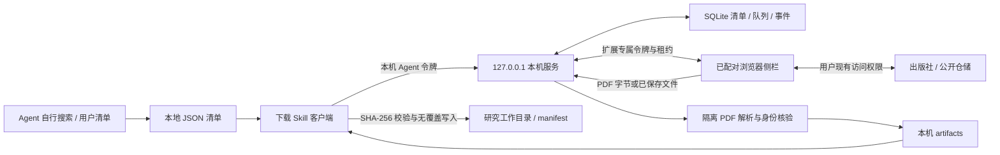

# LitScout Download 架构与拆分

0.1.1 在以下下载流程外增加自动配置层，详见 [自动配置方案](AUTO_SETUP.md)。下载 API 和论文清单 v1 保持兼容；0.1.0 插件在默认端口可继续使用原始配对码。

## 边界

公开目录仅包含下载服务、浏览器扩展、下载 Skill 和它们的测试文档。论文发现由用户或主机 Agent 自己完成；本机服务不访问 LitScout 云端，不读取 CDK。官网链接仅用于品牌导航。没有远程控制平面、管理员账号或计费模块。

## 身份与持久化

| 标识 | 生命周期 |
| --- | --- |
| listId | 本地不可变清单；用户给定或服务生成 UUID |
| paper.id | 清单内的论文标识，缺省按顺序补齐 |
| taskId | 每轮下载 UUID；同幂等键返回原 taskId |
| itemId | 每轮任务中论文执行 UUID；用于上传、核验与导出 |
| browserId | 一次插件/Profile 配对 UUID，与 extension ID 不同 |
| cloudJobId | 可选、不透明的来源关联，不改变执行路径 |

`paper_lists` 保存归一化论文、内容摘要和可选来源；`jobs` 关联清单、浏览器和幂等请求；`items` 保存论文快照、状态、当前租约和文件指针；`events` 保存操作与导出回执；`task_controls` 保存暂停和名称；`browsers` 保存令牌摘要。创建清单和任务在同一个 SQLite 事务完成，同 ID 不同内容拒绝。

一个 task 最多 20 篇，避免不同批次同时打开大量页面；一个浏览器只给队首发租约，人工阻塞不越过。当前任务成功或跳过当前篇后继续。任务级暂停保存在数据库，重启不丢失。完整状态见 API 文档。

## 模块责任

- `schema.py`：论文清单、URL 和唯一性验证，不做搜索或远程元数据补齐。
- `store.py`：事务、幂等、队列状态、浏览器租约、事件；不下载网络资源。
- `app.py`：本机认证边界、流式文件接收、隔离解析、文件读回和导出回执。
- `downloads.py`：仅从专用下载目录读取已保存 PDF；不暴露任意文件读取。
- `pdf_worker.py`：受限子进程提取分页文本并判断题名/DOI；不含 AI/OCR。
- 插件 worker：原页面捕获、下载关联、顺序调度和通知；侧栏：人工操作与可视状态。
- Skill 客户端：提交流程、状态监控与导出；不承载云端发现算法。

沿用成熟的捕获和队列模块，通过新增单一清单协议替换云端入口；移除云端客户端及公开全文云端 worker。没有为未来账户、订阅或搜索引擎预建框架。后续联动只需把搜索结果投影成相同清单，下载端不依赖搜索端实现。

## 安全与恢复约束

本服务是单用户桌面工具，不是多租户服务器。只绑定回环地址，校验 Host，区分 Agent 与扩展 Origin/令牌。PDF 上传绑定 browserId、itemId 和短租约，撤销、取消或暂停后旧上传不能覆盖结果。正文/导出接口只接受 verified 或显式 user_approved；mismatch 被阻止。

PDF 有签名、大小、页数、文本长度和解析超时限制。解析子进程不继承应用令牌，内存上限 512 MiB。导出以 SHA-256 和长度比对内容、原子写入且不覆盖异内容同名文件。扫描文档保留 OCR 状态，不伪造全文。

URL 校验只拒绝明显不适合的输入，不承诺阻止所有浏览器 DNS/跳转行为。浏览器权限较宽，用户必须信任清单来源与插件；详见隐私说明。当前版本不是第三方渗透审计结论。

## 与已安装环境的隔离

公开版使用独立目录、包名 `litscout_download`、默认端口 57133、数据目录 `.litscout-download`、Skill 名 `litscout-browser-download` 和独立扩展目录。端口可配置为 1024–65535，不接管其他服务。测试使用临时 SQLite / Downloads / Profile，不迁移其他版本的插件、配对或文献记录。

若后续需要迁移旧论文，采用用户显式选择的“论文清单导出→新版本提交”，不直接复制旧数据库或令牌。原版数据结构、插件身份和云端任务语义不属于本地清单 v1 的迁移保证。
